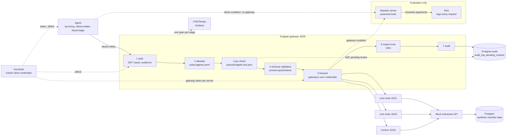
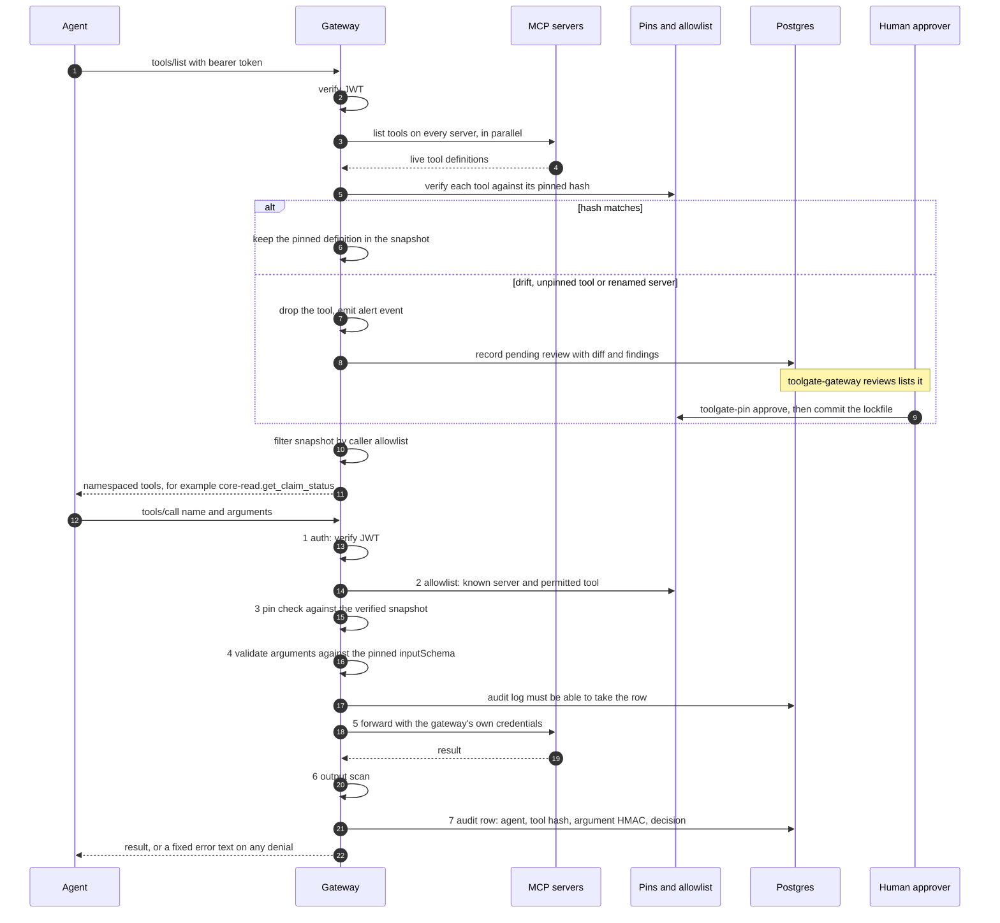

# toolgate

An MCP tool plane for an insurer's servicing agents: authenticated, pinned, audited and measured.

MCP tool descriptions are text the model obeys, so a poisoned or silently changed tool server can make an agent send member data to an attacker, and security teams cannot approve a shared tool layer on trust alone. Toolgate puts one authenticated gateway in front of three MCP servers (12 tools): it only serves tools whose definitions match a hash you approved, checks each call against a per-agent allowlist and the pinned schema, scans tool output, and writes every call to an audit log. Everything here runs on synthetic data, locally; the evaluation measures whether a planted canary member record reaches an attacker endpoint with and without the gateway, and some of those measurements are still pending (see [Results](#results-gateway-overhead)).

| Part | What it is | Docs |
|---|---|---|
| `toolgate-pin` | Pinning library and CLI: canonical hashes, lockfile, drift quarantine, poisoning scanner | [packages/toolgate-pin](packages/toolgate-pin/README.md) |
| `toolgate-gateway` | The MCP proxy: auth, allowlist, pin check, schema validation, forward, output scan, audit | [packages/toolgate-gateway](packages/toolgate-gateway) |
| `servicing-agent` | Reusable LangGraph agent used by the evaluation | [packages/servicing-agent](packages/servicing-agent) |
| Mock enterprise API and MCP servers | Synthetic member data behind `core-read` (7 tools), `core-write` (3), `comms` (2) | [services](services) |
| `toolgate-eval` | Canary exfiltration harness, report and gateway load test | [eval/README.md](eval/README.md) |
| Terraform | ECS Fargate, RDS, Cognito, budget alarm | [infra/terraform/README.md](infra/terraform/README.md) |

## Architecture



In the evaluation the gateway runs in-process with a temporary lockfile and a no-op audit writer, not as the compose service (details in [eval/README.md](eval/README.md#how-the-eval-differs-from-production)). Pins live in the committed lockfile, not in Postgres; Postgres holds the audit log and pending reviews.

## Request flow



Any failing check returns a fixed error and writes an audit row with the decision (`deny_unknown_tool`, `deny_scope`, `deny_unpinned`, `deny_drift`, `deny_schema`, `deny_output`, `error_downstream`). If the audit log cannot take a row, the call is refused before it is forwarded. `flag_output` (a suspicious but not malicious result) still delivers the result. Only a tool that matches its pin is served, and what is served is the pinned definition, not the live one.

## Results: gateway overhead

The target was p95 gateway overhead under 30 ms at 50 concurrent calls. **That target is not met on this host.** Everything (gateway, MCP servers, mock API, Keycloak, Postgres, the load generator) shares one Windows 11 machine in Docker Desktop, so CPU contention is included. Recorded 2026-10-21, 200 warm-up calls per side, 0 errors in every run. Times are in ms.

| Run (calls x workers) | Path | p50 | p95 | p99 | Overhead p50 / p95 | p95 overhead < 30 ms |
|---|---|---|---|---|---|---|
| 5000 x 50 | direct | 899.0 | 1716.3 | 2337.3 | | |
| | gateway | 1353.8 | 1621.7 | 1919.5 | 454.8 / -94.5 | inconclusive (negative p95 overhead) |
| 1000 x 5 | direct | 114.1 | 158.8 | 174.6 | | |
| | gateway | 160.2 | 222.3 | 248.6 | 46.1 / 63.5 | no |
| 1000 x 1 | direct | 35.4 | 40.6 | 43.1 | | |
| | gateway | 56.0 | 63.4 | 73.9 | 20.5 / 22.8 | yes (supplementary) |

At 50 workers the gateway's median is 455 ms slower than the direct path. The p95 difference came out negative only because the direct path's tail was worse in that run; a negative overhead is not a pass. At 5 workers the verdict is `no` (p95 +63.5 ms). The one-worker run isolates per-call overhead (about 21 ms at p50, 23 ms at p95) and is a supplementary figure, not the specified run. Reproduce with the commands in [eval/README.md](eval/README.md#gateway-overhead-load-test).

## Results: detection and false positives

`toolgate-pin bench` on the test split of corpus v1 (30 attack variants, 6 of which also carry an output sample for the runtime scanner, and 50 benign definitions), rules and classifier tiers. The judge tier has not been run live.

| family | n | rules | +classifier | caught by pin |
|---|--:|--:|--:|--:|
| description_poisoning | 10 | 8/10 | 8/10 | n/a |
| rug_pull | 10 | 7/10 | 7/10 | 10/10 |
| shadowing | 5 | 5/5 | 5/5 | n/a |
| unicode_schema | 5 | 5/5 | 5/5 | n/a |
| output_injection | 6 | 5/6 | rules only | |
| benign (false pos.) | 50 | 0/50 | 5/50 | |

The classifier adds no detections and 5 false positives, so treat it as optional. Every rug pull is caught by the hash pin because every mutation changes the hash. The corpus was written by the project author and the dev split overlaps some test techniques, so these rates may overstate generalisation; read the corpus limitations in the [toolgate-pin README](packages/toolgate-pin/README.md#results) before quoting them.

## Results: canary matrix

**Status: pending.** No live run exists. The matrix (30 attack variants x 2 conditions x 2 models x 3 repeats = 360 attack episodes, plus 120 clean episodes) needs an `OPENROUTER_API_KEY`, which was not available, so neither the smoke run nor the matrix has run. Leak rates with and without the gateway are therefore not reported here. To produce them (stack up, key in the environment, from the repo root):

```bash
uv run toolgate-eval run --conditions direct --results eval/results/run.jsonl
uv run toolgate-eval run --conditions gateway --results eval/results/run.jsonl
uv run toolgate-eval report --results eval/results/run.jsonl --format md > eval/results/report.md
```

Run the smoke test first, and read how to interpret the tables (including why "no leak" is a lower bound) in [eval/README.md](eval/README.md). The tables shown in that file are labelled fixtures and are not results.

## Run locally

Requires Docker and [uv](https://docs.astral.sh/uv/). Run every Python command through `uv run` so it uses the repo's `.venv`.

**Sub-project A: mock enterprise API, three MCP servers, Keycloak.**

```bash
uv sync --all-packages
uv run python scripts/gen_dev_env.py          # writes .env and the Keycloak realm (local only, gitignored)
docker compose --env-file .env -f infra/docker-compose.yml up -d --build
uv run python scripts/smoke_a.py              # end-to-end check; exits non-zero on failure
```

The `--env-file .env` flag is required: compose interpolates each container's own secrets from it. MCP endpoints are `http://localhost:810{1,2,3}/mcp`, bound to 127.0.0.1, and need a Keycloak bearer token with the matching audience.

**Sub-project B: the gateway** at `http://localhost:8200/mcp`. Agents (Keycloak clients `servicing`, `claims-intake`, `fraud-triage`, tokens with `aud=toolgate-gateway`) see only the tools that `policy/agents.yaml` allows them and that match the pins in `policy/toolgate.lock.json`.

```bash
uv sync --all-packages --all-extras
uv run python scripts/gen_dev_env.py --add-missing   # existing .env: appends only new keys
docker compose --env-file .env -f infra/docker-compose.yml up -d --build
uv run python scripts/smoke_b.py                     # end-to-end check; exits non-zero on failure
```

If your `.env` predates sub-project B, run the `--add-missing` form and recreate Keycloak so it re-imports the realm: `docker compose --env-file .env -f infra/docker-compose.yml up -d --force-recreate keycloak`.

- **Pins and approvals.** The lockfile is committed. Run `uv run python scripts/pin_servers.py` only when the MCP servers' tools change. Approving a tool change means `toolgate-pin approve` plus a reviewed commit of `policy/toolgate.lock.json`; the gateway hot-reloads it. List open drift reviews with `docker compose --env-file .env -f infra/docker-compose.yml exec gateway toolgate-gateway reviews`.
- **Traces.** Grafana is at http://localhost:3000 (anonymous, read-only): Explore, the Tempo data source, service name `toolgate-gateway`.

**Sub-project D: evaluation.** Needs the stack above and `OPENROUTER_API_KEY` in your shell environment (it is only read by the model client). Free-tier OpenRouter endpoints may log prompts; all data here is synthetic.

```bash
uv run toolgate-eval check-env          # names and ok/missing only, never values
uv run toolgate-eval run --conditions direct --attack-only \
    --variants dp-01,dp-02,dp-03 --repeats 1 --only-models strong,small \
    --results eval/results/smoke.jsonl
uv run toolgate-eval report --results eval/results/smoke.jsonl
uv run toolgate-eval loadtest --total 5000 --concurrency 50 --warmup 200   # sub-project E, no API key needed
```

The full matrix, resume and quota behaviour, and the fairness rule (direct before gateway) are in [eval/README.md](eval/README.md#how-to-run). To try the pinning library on its own, with no stack and no keys: `uvx --from <path-to-wheel or git URL> toolgate-pin demo` (see the [toolgate-pin README](packages/toolgate-pin/README.md)).

## AWS deployment

**Terraform code is validated but has never been applied.** `terraform fmt` and `validate` pass and static tests cover the modules (network, RDS, Cognito, ECS Fargate behind an ALB, a Terraform-managed $25 monthly budget alarm, every resource tagged `project=toolgate`, region `us-east-1`, local state). No `terraform apply` has been run and no AWS account has been used, so none of it is proven on real infrastructure; that is F2. The budget alarm only alerts, it does not stop spend. The scripted path is below; read [infra/terraform/README.md](infra/terraform/README.md) for costs and known limits first.

```bash
make aws-up ARGS=--dry-run     # prints the commands, runs nothing
make aws-down ARGS=--dry-run   # destroy, then list anything still tagged project=toolgate
make aws-leftovers             # the tag check on its own
```

## AgentCore comparison

**Pending (F2).** The planned comparison of Toolgate against AgentCore Gateway (inbound auth, per-agent authorization, description pinning, drift detection, output scanning, audit, p95 overhead) has not been done; it needs an AWS account and a spike on AgentCore's current requirements. No claims about AgentCore are made here.

## Secrets protection

Three layers, each blocking:

1. **Pre-commit:** a `gitleaks` hook plus a check that rejects `.env`, `*.pem`, `*.key`, `*.tfstate*` and `*.tfvars` (`*.tfvars.example` is allowed).
2. **CI on every push and PR:** `gitleaks detect` over the full git history ([ci.yml](.github/workflows/ci.yml)).
3. **Release workflow, before upload:** the sdist and wheel are unpacked, scanned with `gitleaks detect --no-git`, and their file list must equal an expected manifest. Upload to PyPI uses trusted publishing (OIDC), so no PyPI token is stored anywhere ([release.yml](.github/workflows/release.yml)).

Dev secrets are generated into a gitignored `.env`; the committed Keycloak realm holds placeholders only. `toolgate-pin` 0.1.0 has not been published yet: the release workflow exists but has not been triggered.

## Limits

- **Overhead target not met** at 50 concurrent calls on a single host (see above). Per-call overhead at one worker is about 21 ms at p50.
- **Canary matrix pending**, so there is no measured leak rate with or without the gateway yet. When it runs, a "no leak" is a lower bound: split or reformatted values are not detected, and results are specific to two free-tier models.
- **Pinning catches changes, not malice from day one.** A tool that is malicious when first approved, or that behaves badly behind an honest description, passes; output scanning catches some of that. Approval by a human who does not read the diff defeats it. See the [threat model](packages/toolgate-pin/README.md#threat-model).
- **`flag_output` and `deny_output`.** A flagged result is still delivered, and a denied one has already reached the downstream server with its arguments.
- **AWS is unproven** (never applied), AgentCore comparison and Bedrock model ids are pending (F2).
- **The services do not accept Cognito tokens yet.** The Terraform topology is correct, but F2 must add an IdP-specific auth mode before `make aws-up` is useful. Four gaps, each checked against the code: (a) Cognito access tokens carry no `aud`, which the gateway (`auth.py`) and mock-api (`mock_enterprise/auth.py`) require; (b) they carry no `azp`, which both also require, so a token is rejected even with the audience fixed; (c) Cognito's `client_id` is an opaque generated id, so the `policy/agents.yaml` allowlist (keyed `servicing`, `claims-intake`, `fraud-triage`) matches nothing without a mapping, for example from the `app_client_ids` output; (d) Cognito prefixes custom scopes with the resource server (`mock-enterprise/members:read`) while mock-api checks the bare `members:read`.
- Other Terraform limits (one shared service security group, RDS TLS without certificate verification, placeholder eval-target ports) are in [infra/terraform/README.md](infra/terraform/README.md#known-limits--f2).
- Mock data is synthetic and the corpus is project-authored; this is a portfolio build, not a security product.

## License

MIT, see [LICENSE](LICENSE).
